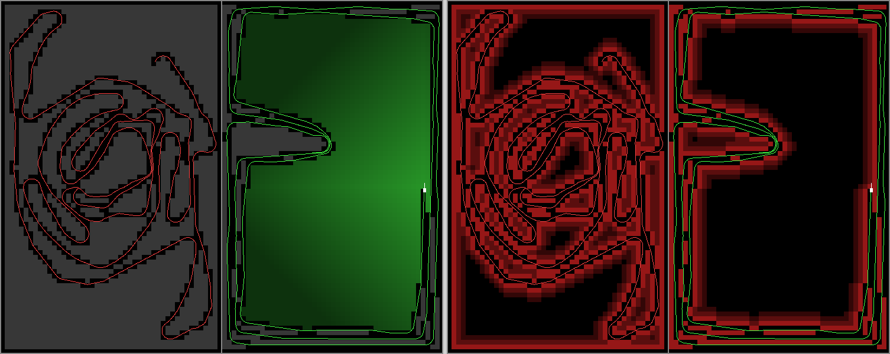

# Bots that read the arena: territory, room and risk

Status: **research branch `research/bots-territory`** (built on the benchmark harness and
rollout speed-ups of `research/performance`). Results and the merge recommendation are at
the end.

Related: [local-and-ai.md](./local-and-ai.md) (the bots: rollouts, goals, profiles),
[research/performance.md](./research/performance.md) (the benchmark harness).

## Problem

A bot decides where to steer by simulating a handful of manoeuvres pixel by pixel
(`local-and-ai.md`, "Steering"). What it knows about the arena beyond those 130–180 px is one
number per manoeuvre: a flood fill of the coarse grid from the end of the path, capped at
400 cells (160 × 160 px), meaning "is there room right ahead". So a bot

- cannot tell a 400-cell chamber from the rest of the arena, and once cut off from its
  enemies wanders about its region, cutting it into pieces, instead of filling it;
- counts room that lies behind a wall (the flood fill starts 12 px ahead or to the side of
  the path's end, wherever that lands) and room it could only get back to by turning
  around on the spot;
- treats all free space alike, whoever gets to it first;
- chases enemies and items it has no chance of reaching in time.

Measured before this work (80 rounds, hard against hard): on *Bricks* and *Portals*
35–40 % of all deaths are crashes inside a pocket with no enemy in it ("boxed, alone" in the
tables below); on *Blank* fewer than 10 %, where bullets decide.

## What the bots know now

Three modules, all in `src/game/ai/`:

| Module | What it is |
|--------|-----------|
| `territory.ts` | `TerritoryMap`: one per game, shared by its bots. Pure typed-array data computed from the coarse grid. No DOM, no randomness. |
| `territorySense.ts` | `TerritorySense`: one per bot. Reads the map for the planner: judges a simulated path, picks goals. |
| `territoryView.ts`, `TerritoryOverlay.ts` | Pictures of the map: for the snapshot script and the `?botdebug` overlay. |

`BotController` itself changes in five places (profile field, one call per decision, the
"room" term of the score, the final pick, two lines in goal choice); the rollout loop is
untouched.

### The map

Everything is computed on the coarse grid that `PixelGrid` already maintains: 94 × 75 cells of
8 × 8 px, a cell being *blocked* if it holds any solid pixel. Neighbours are the four sides,
wrapping around the arena edges (a level with a border is simply blocked there).

| Layer | Contents | How |
|-------|----------|-----|
| `blocked` | Snapshot of the obstacles: trails and scenery (1), and the cells a level door covers now or within 37 ticks (2) | Copy of the coarse counts + a per-level table of door cells per animation frame |
| `link` | Portal cells → the cell at the other end | From `game.portals` |
| `clearance` | Cells to the nearest blocked cell (capped at 6) | Breadth-first from all blocked cells at once (exact with wrap-around, unlike a two-pass distance transform) |
| `risk` | How easy it is to crash in a cell, whoever you are | 6 / 3 / 1 for clearance 1 / 2 / 3; +8 in a doorway that closes within 120 ticks; +6 in the fire zone of a level gun |
| `region`, `regionSize` | Connected free regions (through portals too) and their sizes | Flood fill labelling, on demand (`labelRegions`): tools and tests use it, the bots do not need it |
| `time[slot]` | When each player can be in each cell. Blocked cells have a time too where a Shield or a Crossing item gets the player through them | Breadth-first from the player's head |
| `foeTime[slot]` | When the first *enemy* of that player can be there | Minimum over the other players; team-mates are left out |
| `reach`, `roomy`, `area`, `shared` per slot | Cells the player can reach; of those, the ones not touching an obstacle; the ones it reaches before every enemy (its Voronoi territory); the ones an enemy can reach too (0 = the player is alone in its region) | One pass over the cells |

Details of the per-player search:

- **Time, not distance.** A cell costs 2 units at normal speed, 1 with Turbo, 4 when slowed
  (automatic effects; holding the Turbo weapon is not anticipated).
- **Heading.** The first step costs extra when the player would have to turn for it: +2 cells
  to the side, +5 backwards (a U-turn is about 45 px of driving).
- **No leaking through walls.** A head's own cell is nearly always "blocked" (its trail is
  in it), and it may hold a wall with free space on the other side. The search leaves the
  head's cell towards a neighbour only if the pixels between are free.
- **Doors** count as closed if they are solid now or within the door margin, so a region
  behind a closed door is not reachable and a doorway about to close is not a way out.
- **Portals** are one extra edge per portal cell.
- **Shield and Crossing.** A player with a Shield gets into blocked cells (trails and
  scenery, never doors, as in the game) for as long as the Shield lasts; one with a Crossing
  item into the cells that hold its own trail and nothing else (64 pixels looked at, once
  per cell and search). "As long as it lasts" is the effect's remaining ticks minus 30, the
  planner's margin, at a pixel per tick: a cell entered later than that is a wall again, so
  the item opens what the player can get to in time and nothing further. With either item
  the head also leaves its own cell through what the item passes. This holds for every
  player, so a bot sees an enemy with a Shield coming through the wall it hides behind
  (`foeTime`, `shared`, `area`). What the map does not do: the room a bot counts at the end
  of one of its own paths (`TerritorySense`) still stops at every trail, and nobody is
  expected to pick an item up.

Enemy trails are taken as they are now: nobody's future path is predicted.

### Update schedule

The map is refreshed over 12 ticks, a slice every other tick, by whichever bot asks first
that tick: tick 0 the arena layers (obstacles, portals, clearance, risk), ticks 2–8 one
player each, tick 10 the comparison (`foeTime`, areas). So the map is at most 12 ticks
(12 px, a cell and a half) old, the cost is spread, and all bots of a game share it. A new
round, a new level or a gap in the ticks rebuilds everything at once (about 0.45 ms, once
per round). Nothing is allocated after construction. Games without a bot that uses the map
never build it.

Everything derives from the game state and the tick number: matches stay deterministic.

### How a path is judged (`TerritorySense`)

The planner's score keeps its shape (`local-and-ai.md`); the term "how much room is left
once this path has been driven" is now computed like this:

1. **Nothing to count.** A path whose cells all keep more than three cells away from every
   obstacle, and that does not come back to itself, cannot cut anything off: all the bot can
   reach stays in reach. No flood fill at all. This is most paths in the open, and it is why
   a decision is now cheaper than before (see "Cost").
2. Otherwise the cells of the path are walls, **and so are the cells within two cells of
   it** (16 px), except beside its last five cells: there is no room to turn around next to
   one's own trail (the turning circle is 28 px across), so the space beside the path is not
   a way back.
3. The count starts 12 px ahead of the path's end, or to the sides if that is blocked —
   **only where the pixels in between are free** (with the same squeeze rule as the real
   collision, so a ray does not slip between two diagonal pixels of a slanted trail). The
   room behind a wall is not ours.
4. Breadth-first from there up to 400 cells, as before. `room = cells / plenty`, where
   *plenty* is the profile's `roomCap` or everything the bot can reach, whichever is less.
   The score loses `(1 − room) × lookahead`.
5. **Looking further, for the winner only** (`review`). With `roomCap` above 400 (hard:
   1400), a path whose count reached 400 is provisionally taken to have plenty. When all
   candidates are scored, the best one is counted on up to *plenty*; if that costs it the
   lead, the next best is checked the same way (two passes). This is what lets a bot tell
   which side of a cut is bigger, without long flood fills for every candidate.

A cell can also count for less than 1: `foeWeight` for cells an enemy reaches before the
bot would (path length + layers of the flood against `foeTime`) — implemented, measured,
and left at 1 (see "What did not help").

Two more terms come from the same path cells:

- **Risk**: `−riskWeight × Σ risk` over the cells of the path. Implemented, measured, and
  left at 0 (same section).
- **Filling** (hard only), when `shared = 0` — no enemy can reach the bot's region and the
  round goes to whoever lasts longer:
  - cells touching an obstacle count 0.3: the strips left between two passes are not room;
  - **+8 per path cell that touches a wall or a trail, +3.2 per cell one further out,
    times `room`**: the bot goes round its region along the walls and spirals inwards
    instead of crossing it, but never follows a wall into a pocket for the bonus;
  - no hunting.

### Goals

- **Items** (normal, hard): an item is ignored if the bot cannot reach it, or if an enemy
  gets there more than 3 cells earlier.
- **Expanding** (`expands`, off): with nothing else to do, head for the nearest open point
  of the border between the bot's territory and an enemy's. Measured, no gain.
- **Hunting unarmed** (hard): instead of aiming 45 px ahead of the prey, the bot aims at the
  nearest point on the prey's course (4–36 cells ahead) that it reaches at least 2 cells
  earlier than the prey. If there is no such point the prey is ahead everywhere and
  chasing it would mean following it into its own territory: no goal. Armed bots face the
  enemy as before.

### Per profile

| | easy | normal | hard |
|-|------|--------|------|
| Uses the map | no (never built for it) | yes | yes |
| Room: nothing behind walls or beside the own path counts | – | yes | yes |
| Leaves items it loses the race for, or cannot reach | – | yes | yes |
| Room relative to 1400 cells (which side of a cut is bigger) | – | no (400) | yes |
| Fills its region when alone in it | – | no | yes |
| Cuts enemies off where it gets ahead of them; does not chase otherwise | – | (does not hunt unarmed) | yes |
| Enemy-first cells count for less (`foeWeight`), risk cost (`riskWeight`) | – | off | off |

`BotProfile.territory` holds these switches (`TerritoryUse`); `null` reproduces the bots of
before exactly (`npm run bench:fingerprint -- --no-territory` matches the old baseline).

## Alternatives considered

| Idea | Verdict |
|------|---------|
| **Voronoi / multi-source BFS on the coarse grid** | Chosen, as one BFS *per player* rather than a single multi-source pass: about the same cost for four players, and it gives arrival times that the per-path judgement and the goals need (who is first *and by how much*), plus per-team enemies for free. |
| **Full Voronoi per candidate path** (the classic Tron evaluation: territory after my move) | Too expensive: 9–25 paths per plan, a plan every 2 ticks, ~40 µs per BFS. Replaced by the capped flood from the path's end that compares its own arrival with the stored `foeTime`. |
| **Articulation points / chamber tree** (don't enter a chamber through a one-cell neck unless it is bigger than the alternative) | Not implemented. On an 8-px grid with a 1-px trail the bot's own path is what closes necks, and the judgement already treats the path, thickened, as a wall: entering a chamber through a neck leaves the chamber as the only room, and its size is compared with the alternative (test: "takes the larger of two chambers"). Tarjan on 7 000 cells every refresh would cost about as much as the rest of the map together. |
| **Distance transform for clearance** | Chosen, as a BFS (exact with wrap-around). Feeds `risk`, the wall-hugging bonus and the thin-cell discount. |
| **Influence maps** (smooth decaying fields per player) | Rejected: arrival times say the same thing in units that can be compared with a path's length; a decaying field needs tuning per level size. |
| **Enemy lines of fire and satellites in the risk map** | Left in the rollouts, where they already are per pixel and per step (`local-and-ai.md`, "Match-ups"); rasterising cones into cells every refresh would cost more and know less. The map's risk is the part that does not depend on who is looking. |
| **A dedicated wall-follower for endgames** | Not tried: the bonus per wall-touching path cell gets most of the way with ten lines. A real space-filling planner (finish a side chamber before sealing it) is the obvious next step. |

## Tools

- `npm run bots:strength -- --drivers=hard,old-hard --levels=bricks --rounds=80` — head to
  head, seats rotated, deaths classified by the room the victim had a second earlier.
  `old-<profile>` is the bot without the map. `node scripts/bots/batch.mjs jobs.txt` runs
  many such lines in parallel and totals them.
  `--log-deaths` prints, for every death, the arguments that replay it in the next two.
- `npm run bots:snapshots -- --drivers=hard,old-hard --level=bricks --seed=3 --out=dir` —
  PNGs of a seeded match every 5 s and at every death: territory on the left, risk on the
  right.
- `npm run bots:trace -- ... --seat=0 --from=41 --to=42` — the planner's candidates and
  scores around a moment of a replayed round.
- `npm run bots:cost` — what a decision costs with and without the map, on identical
  states.
- `node scripts/bots/overlay-shot.mjs dir portals` — screenshots of the overlay below in
  headless Chrome.
- **`?botdebug=1`** in the game URL (local game or host): the territory layer over the
  arena, with the cells each player owns and can reach; `?botdebug=risk`, `=clearance`; the
  **B** key cycles the layers. With it the simulation runs on the page and not in the
  worker, as the overlay reads it.

## Results

All numbers from `node scripts/bots/batch.mjs scripts/bots/validation.jobs.txt` on the
final code (seeded; seats rotated; `old-*` = the same profile with `territory: null`).
A round is won by the last player alive; draws and rounds cut at 120 s count for nobody.
± is the 95 % interval of a win rate; with 160 rounds it is ±8 points, so single levels say
little and the totals are what counts.

### New against old, head to head (win %, 160 rounds per level)

| Level | hard | old hard | normal | old normal |
|-------|-----:|---------:|-------:|-----------:|
| Blank | 50.6 | 48.1 | 55.6 | 41.9 |
| Pop Culture | 60.6 | 36.9 | 48.1 | 50.6 |
| Selva | 50.0 | 49.4 | 60.6 | 39.4 |
| Bricks | 55.6 | 43.1 | 54.4 | 44.4 |
| Bus | 56.3 | 43.1 | 56.9 | 41.3 |
| Dentistry | 61.9 | 36.3 | 56.3 | 42.5 |
| Warzone | 50.0 | 50.0 | 56.3 | 43.8 |
| Portals | 58.1 | 41.3 | 48.1 | 50.6 |
| **All (1280 rounds)** | **55.4 ±3** | **43.5 ±3** | **54.5 ±3** | **44.3 ±3** |

Hard wins 709 rounds to 557, normal 698 to 567.

### Other match-ups

| Match-up | After | Before |
|----------|-------|--------|
| normal – easy (240 rounds: Blank, Bricks, Bus) | 85.8 – 13.3 | 80.0 – 19.2 |
| hard – normal (240) | 55.0 – 44.2 | 45.4 – 54.2 |
| hard – easy (240) | 81.7 – 17.9 | 78.8 – 20.8 |
| normal – straight driver (160, all levels) | 97.5 – 2.5 | 99.4 – 0.6 |
| Deaths in the first 3 s, per 1280 seats (hard / normal) | 29 / 24 | 33 / 42 |

| Four players | New | Old |
|--------------|-----|-----|
| FFA, 2 new hard + 2 old hard (320 rounds; win % per seat, 25 = par) | 29.5 | 20.5 |
| FFA, 2 new normal + 2 old normal (320) | 29.2 | 19.8 |
| Teams, 2 new hard against 2 old hard (240 rounds; win % of the team) | 52.5 | 47.1 |
| Teams, 2 new normal against 2 old normal (240) | 54.6 | 45.0 |

FFA with one easy, one normal and two hard (160 rounds, win % per seat): after 7.5 / 33.1 /
29.1, before 9.4 / 33.8 / 27.8. Normal already won more often than either hard bot there;
that has not changed. The team result for hard (+5 points) is within the noise.

| Left alone (no hunting, no shooting; median seconds until the first of two dies, 40 rounds) | After | Before |
|---|---:|---:|
| hard, Blank | 42.2 | 39.5 |
| hard, Bricks | 49.3 | 44.3 |
| normal, Blank | 50.2 | 31.3 |
| normal, Bricks | 50.9 | 46.4 |

| Pure space filling (each player closed in half the arena, no items) | |
|---|---|
| hard against old hard, 40 rounds | 40 – 0 |
| Two new hard: median time to the first death | 154.5 s |
| Two old hard | 92.1 s |

*72 s into a round on the split arena: the old hard bot (left half) has just died after
cutting its half into pieces; the new one has gone round its half twice and has most of
it left.*

### What kills the bots

Deaths in the head-to-head rounds above (1280 seats per column). Crashes are classified by
the room the victim had (cells it could reach) one and six seconds before: *trapped* = had
600 cells or more six seconds earlier and under 600 a second before the crash; *ran out* =
had been confined for a while; *alone* / *enemy about* = whether an enemy could reach the
same space.

| Cause | hard | old hard | normal | old normal |
|-------|-----:|---------:|-------:|-----------:|
| Shot (tracer, bullet, bomb, satellite) | 302 | 393 | 343 | 389 |
| Crashed with room to spare (accident, squeeze, sudden cut-off) | 173 | 145 | 104 | 127 |
| Trapped, enemy about (cut off, or drove into a pocket in a fight) | 29 | 85 | 45 | 111 |
| Trapped, alone (boxed itself in) | 12 | 20 | 16 | 24 |
| Ran out of room, alone (lost the endgame) | 34 | 66 | 61 | 54 |
| Ran out of room, enemy about | 7 | 1 | 0 | 0 |
| Crushed by a door | 3 | 2 | 5 | 0 |
| **All deaths** | **560** | **712** | **574** | **705** |

The deaths the map was meant to prevent (trapped, or out of room) go from 172 to 82 for
hard and from 189 to 122 for normal. For normal, whose only changes are the corrected room
judgement (nothing behind walls, nothing beside the own path) and the item race, "trapped,
enemy about" falls from 111 to 45. Fewer bots are shot as well. Crashes with room to spare
went up for hard (145 to 173). What is left is mostly combat (over half of all deaths),
which this work does not touch. Door deaths are too few to compare here; in 320 rounds of
the match of `tests/doors.test.ts` (calm normal against calm hard on Portals) the new bots
are crushed 3 times and the old ones 9.

Replaying individual deaths (`--log-deaths`, `bots:snapshots`, `bots:trace`) found three
defects, the first two fixed:

1. A filling bot with 4 000 cells followed a wall through a 20-px gap into a 180-cell
   corner, for the wall-following bonus. The bonus is now multiplied by the room.
2. A U-turn into the strip between two of the bot's own passes was judged roomy on some
   ticks and deadly on others: the probe ray that looks for free space beside the path's
   end slipped between two diagonal pixels of a slanted trail. The ray now obeys the same
   squeeze rule as the real collision.
3. Not fixed: a bot that stays in "its" quadrant of *Bricks* from the start, serpentining,
   until its own trail closes the quadrant's exits; the enemy then has several times as
   much room ([picture](./research/bots-territory/bricks-boxed-in-own-quadrant.png)).
   While the exits are open everything looks roomy. A goal that takes the bot to the
   border of its territory was tried against this (`expands`) and did not help; see below.

### What did not help (implemented, measured, switched off)

800 rounds each over Blank, Bricks, Selva, Portals and Bus (±3.5 points per side).

| Variant | Result |
|---------|--------|
| `foeWeight` 0.5 (cells an enemy reaches first count half) on top of filling | 50.6 – 48.8 against old hard; filling alone 51.6 – 47.5 |
| `riskWeight` 0.3 (clearance, doorway and level-gun risk along the path) on top of filling | 49.9 – 49.6 |
| `expands` (head for the border of the own territory when idle), hard, against hard as it is | 48.6 – 50.9 |
| `expands`, normal, against normal as it is | 48.8 – 49.8 |
| `fills` for normal, against old normal | 55.3 – 43.3; without it 56.9 – 41.8 |
| `roomCap` 1400 for normal, against normal as it is | 50.7 – 47.8 |

What the switched-on features were worth, measured the same way against old hard on an
earlier version of the branch: filling and the corrected room 51.6 – 47.5; with the item
race 56.1 – 43.4; with cut-off goals instead 52.3 – 46.4. Room relative to 1400 cells
instead of 400 (then counted in full for every path): 57.3 – 41.8 against 54.4 – 44.3 over
1600 rounds each. That 3-point difference is suggestive rather than established; hard has
it in the cheap two-pass form.

### Shield and Crossing on the map

Added after the merge. 1280 rounds per match-up (8 levels × 2 seeds × 80), items on, the
same seeds before and after (±3):

| Match-up | Before | After |
|----------|--------|-------|
| hard / old-hard | 51.6 / 48.0 | 53.8 / 45.9 |
| normal / old-normal | 55.0 / 44.4 | 55.7 / 44.1 |
| normal / straight | 98.0 / 2.0 | 98.0 / 2.0 |

No loss; the gain for hard is inside the interval. Shields and Crossing items are rare
enough that the totals could hardly move. The cost was not measured again: without one of
the two effects the search is the same loop with one more comparison per blocked cell.

## Cost

`npm run bots:cost`: three hard bots and a wanderer play; every tick, controllers of each
profile decide on the same state. Microseconds, mean / 99th percentile, in Node on the
development laptop.

| Level | One decision: normal | hard | Three bots in a tick, map included: normal | hard |
|-------|------|------|------|------|
| Blank | 53 / 239 → 44 / 217 | 98 / 317 → 91 / 322 | 156 / 546 → 164 / 533 | 284 / 753 → 290 / 825 |
| Bricks | 59 / 257 → 51 / 235 | 110 / 334 → 107 / 335 | 179 / 665 → 184 / 646 | 336 / 880 → 354 / 954 |
| Selva | 61 / 259 → 53 / 237 | 113 / 334 → 111 / 334 | 192 / 677 → 208 / 689 | 361 / 875 → 395 / 973 |
| Warzone | 61 / 270 → 53 / 248 | 112 / 348 → 108 / 348 | 187 / 701 → 200 / 701 | 346 / 926 → 375 / 1017 |
| Portals | 68 / 327 → 60 / 303 | 130 / 456 → 126 / 457 | 200 / 793 → 209 / 780 | 385 / 1133 → 401 / 1150 |

- A decision by itself is slightly cheaper than before: paths that touch nothing are no
  longer flood-filled. Easy bots: 7 µs, unchanged (they never touch the map).
- The map costs 26–34 µs per tick for the whole game (99th percentile of a slice
  130–165 µs), whatever the number of bots. A full rebuild takes 0.3–0.6 ms once per round
  and happens during the countdown.
- Together: +2 to +9 % mean for three hard bots (Portals, the most expensive level:
  385 → 401 µs mean, 1133 → 1150 µs p99; largest increase, Selva: +9 % mean, +11 % p99),
  +3 to +8 % for three normal bots. Nothing is allocated in the map or the judgement.
- Counting every path's room up to 1400 cells instead of the best two would cost +21 to
  +38 % (Blank 282 → 342, Selva 360 → 498, Portals 435 → 543 µs for three hard bots).

`npm run bench:sim` (a real `HostSession`, 60 s per scenario) plays different matches once
the bots behave differently, so it is not like for like, and it shows more:

| Scenario | Bots per tick, mean / p99 (µs): before → after | Per live bot per tick | Allocated per tick |
|----------|------|------|------|
| 3 easy | 17 / 97 → 16 / 64 | 9 → 8 | 61 → 54 KB |
| 3 normal | 113 / 566 → 145 / 578 | 61 → 65 | 91 → 108 KB |
| 3 hard | 212 / 627 → 343 / 950 | 106 → 123 | 139 → 213 KB |
| 4 hard | 193 / 516 → 290 / 1106 | 96 → 127 | 121 → 172 KB |
| 3 hard, Portals | 284 / 1006 → 336 / 1134 | 140 → 146 | 130 → 155 KB |
| 3 hard, Warzone | 256 / 857 → 270 / 953 | 125 → 137 | 154 → 183 KB |

"Before" is this branch with `--no-territory`, which reproduces the old bots exactly.
Bot-ticks in the measured minute for 3 hard: 8441 → 11736, so part of the rise is bots
being alive for more of the time. Why the cost per live bot is also higher here (+16 % for
3 hard) while the like-for-like table shows about +5 % was not established; the likely
reason is that the new matches spend more time in tight places, where rollouts cost more
for old and new alike. Nothing was measured in a browser or on a phone.

## With the human-like bots (merged)

The numbers above are for the planner alone. The branch was rebased on the human-like bots
([bots-human.md](./bots-human.md)) and merged; what changed with it:

- **A map per bot, of the perceived world.** The planner of a human-like bot is handed the
  world as the bot perceives it, and the map is keyed on that: enemy heads are on it where
  the bot believes them to be. Planners without the human layer (strength 0, tools) still
  share the true map of the game.
- **A slower look.** `TerritoryUse.refreshTicks` (from the human profile's `arenaGlance`:
  hard 24, normal 36 ticks) spaces the six slices of a refresh further apart. Measured in
  bots-human.md, "The arena as a whole": no loss against the 12-tick refresh.
- **Still worth it under the human layer**: with the map hard wins 53.8 % of rounds
  against 45.8 % for hard without it, normal 56.1 % against 43.5 % (1280 rounds each).
- **Cost** (`npm run bench:sim`, whole tick, mean / 99th percentile in µs; not like for
  like, the matches differ): 3 normal 136 / 717 → 179 / 972, 3 hard 182 / 720 → 242 / 870,
  4 hard 318 / 1115 → 315 / 1278, 3 hard on Portals 403 / 1328 → 453 / 1495. The budget
  of a tick is 14 286 µs. The worst single tick rises to 2.4–3.5 ms: each bot now builds
  its own map on the first tick of a round (the build during the countdown is of the true
  map, which human-like bots do not use).
- Trails and walls are on the map as they are, not as perceived (nothing in the human
  layer delays them).
- Driver specs for experiments: `old-hard` (no map), `g48-hard` (refresh every 48 ticks).

## Recommendation (as written before the merge)

**Merge**, after `research/performance` (this branch is built on it and uses its harness).
Both profiles that use the map win 54–55 % of rounds against their old selves (43–44 % the
other way) over 1280 rounds each, the deaths it was aimed at are roughly halved, and hard
now beats normal head to head.

Open risks:

- **Not played by a human.** Wall-hugging endgames and bots that no longer chase from
  behind may feel different.
- **End-to-end bot time** rises more in `bench:sim` than in the like-for-like table (see
  above), and `npm run bench:browser` on a real or emulated phone was not run.
- **`research/bots-human`**: the map reads the true game state. If bots get human-like
  perception, decide whether to feed the map the perceived state.
- The fingerprint baseline changed, as it must (`scripts/bench/fingerprint.baseline.json`;
  the old one is kept as `fingerprint.no-territory.json`, which `--no-territory` still
  reproduces).
- Enemy movement is not predicted, nor the Turbo weapon; the map is up to 12 ticks old.
